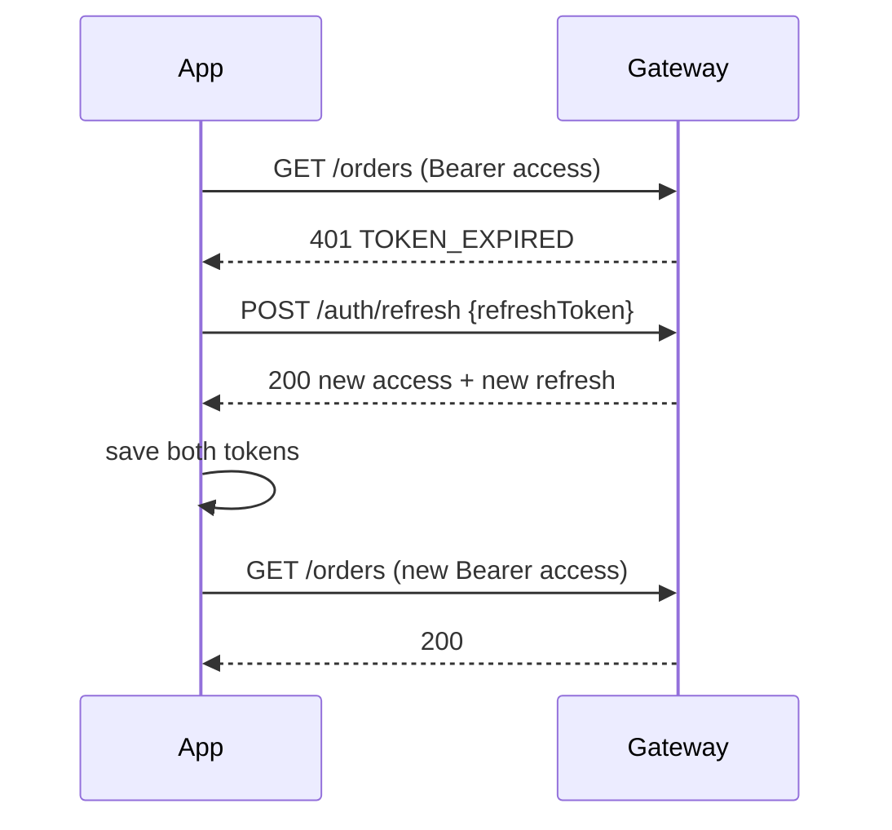

# Flutter Integration Guide

For Dev 4 and anyone building the Customer, Manager, Rider or Admin apps.
Read `API_REFERENCE.md` for the endpoint details. This guide gives you code you can paste in.

## 1. The five rules

1. Talk **only** to the gateway (`:8080`). Never to 8081 to 8083.
2. After login, store `accessToken` and `refreshToken` in `flutter_secure_storage` (not SharedPreferences).
3. Send `Authorization: Bearer <accessToken>` on every call except `/auth/*`.
4. On `401` with `code == TOKEN_EXPIRED`: refresh **once**, save the new pair, repeat the call.
5. On `TOKEN_INVALID` or `ACCOUNT_DISABLED`, or if refresh fails with 401/403: clear storage and show the login screen.
   Do **not** log out on `403 ACCESS_DENIED`. That only means "your role cannot do this".



## 2. Setup

`pubspec.yaml`:

```yaml
dependencies:
  dio: ^5.7.0
  flutter_secure_storage: ^9.2.2
```

Suggested folders:

```
lib/core/api/   api_config.dart  api_exception.dart  token_storage.dart  api_client.dart
lib/core/models/ role.dart  app_user.dart  address.dart  store.dart
lib/features/auth/ auth_repository.dart
```

### Android (plain http during development)

`android/app/src/main/AndroidManifest.xml`, on the `<application>` tag:

```xml
android:usesCleartextTraffic="true"
```

Also make sure `<uses-permission android:name="android.permission.INTERNET"/>` is present (it is in release manifests by default, check debug/profile).

### iOS (plain http during development)

`ios/Runner/Info.plist`:

```xml
<key>NSAppTransportSecurity</key>
<dict>
  <key>NSAllowsLocalNetworking</key>
  <true/>
</dict>
```

Remove cleartext and use HTTPS before release.

### Real phone

Phone and laptop on the same Wi-Fi, run with `--dart-define=API_BASE_URL=http://<laptop-ip>:8080/api/v1`, and allow port 8080 in the laptop firewall.

## 3. Code

### `api_config.dart`

```dart
import 'package:flutter/foundation.dart';

class ApiConfig {
  /// Override with: flutter run --dart-define=API_BASE_URL=http://192.168.1.20:8080/api/v1
  static const String _override = String.fromEnvironment('API_BASE_URL');

  static String get baseUrl {
    if (_override.isNotEmpty) return _override;
    if (kIsWeb) return 'http://localhost:8080/api/v1';
    if (defaultTargetPlatform == TargetPlatform.android) {
      return 'http://10.0.2.2:8080/api/v1'; // Android emulator -> your laptop
    }
    return 'http://localhost:8080/api/v1'; // iOS simulator / desktop
  }
}
```

### `role.dart` and `app_user.dart`

```dart
enum Role { customer, manager, rider, admin }

Role roleFromApi(String value) => Role.values.byName(value.toLowerCase());

class AppUser {
  final String id;
  final String fullName;
  final String email;
  final String? phone;
  final Role role;
  final String status; // ACTIVE | DISABLED
  final String? storeId; // UUID; only MANAGER and RIDER

  const AppUser({
    required this.id,
    required this.fullName,
    required this.email,
    required this.phone,
    required this.role,
    required this.status,
    required this.storeId,
  });

  factory AppUser.fromJson(Map<String, dynamic> j) => AppUser(
        id: j['id'] as String,
        fullName: j['fullName'] as String,
        email: j['email'] as String,
        phone: j['phone'] as String?,
        role: roleFromApi(j['role'] as String),
        status: j['status'] as String,
        storeId: j['storeId'] as String?,
      );
}
```

### `address.dart` and `store.dart`

```dart
class Address {
  final String? id;
  final String? label;
  final String line1;
  final String? line2;
  final String city;
  final String? state;
  final String postalCode;
  final String? country;
  final bool defaultAddress;

  const Address({
    this.id,
    this.label,
    required this.line1,
    this.line2,
    required this.city,
    this.state,
    required this.postalCode,
    this.country,
    this.defaultAddress = false,
  });

  factory Address.fromJson(Map<String, dynamic> j) => Address(
        id: j['id'] as String?,
        label: j['label'] as String?,
        line1: j['line1'] as String,
        line2: j['line2'] as String?,
        city: j['city'] as String,
        state: j['state'] as String?,
        postalCode: j['postalCode'] as String,
        country: j['country'] as String?,
        defaultAddress: (j['defaultAddress'] as bool?) ?? false,
      );

  Map<String, dynamic> toJson() => {
        'label': label,
        'line1': line1,
        'line2': line2,
        'city': city,
        'state': state,
        'postalCode': postalCode,
        'country': country,
        'defaultAddress': defaultAddress,
      };
}

class Store {
  final String id;
  final String code;
  final String name;
  final String? line1;
  final String? city;
  final String? state;
  final String? postalCode;
  final String? phone;
  final bool active;

  const Store({
    required this.id,
    required this.code,
    required this.name,
    this.line1,
    this.city,
    this.state,
    this.postalCode,
    this.phone,
    required this.active,
  });

  factory Store.fromJson(Map<String, dynamic> j) => Store(
        id: j['id'] as String,
        code: j['code'] as String,
        name: j['name'] as String,
        line1: j['line1'] as String?,
        city: j['city'] as String?,
        state: j['state'] as String?,
        postalCode: j['postalCode'] as String?,
        phone: j['phone'] as String?,
        active: j['active'] as bool,
      );
}
```

### `api_exception.dart`

One exception type for the whole app, so screens only handle `ApiException`.

```dart
import 'package:dio/dio.dart';

class ApiException implements Exception {
  final int? status;
  final String code; // backend code, or NETWORK_ERROR / TIMEOUT / UNKNOWN
  final String message;

  const ApiException({this.status, required this.code, required this.message});

  factory ApiException.fromDio(DioException e) {
    final data = e.response?.data;
    if (data is Map && data['code'] is String) {
      return ApiException(
        status: e.response?.statusCode,
        code: data['code'] as String,
        message: (data['message'] as String?) ?? '',
      );
    }
    switch (e.type) {
      case DioExceptionType.connectionTimeout:
      case DioExceptionType.sendTimeout:
      case DioExceptionType.receiveTimeout:
        return const ApiException(code: 'TIMEOUT', message: 'The server took too long to respond');
      case DioExceptionType.connectionError:
        return const ApiException(code: 'NETWORK_ERROR', message: 'Cannot reach the server');
      default:
        return ApiException(status: e.response?.statusCode, code: 'UNKNOWN', message: e.message ?? 'Unexpected error');
    }
  }

  /// Text that is safe to show to end users.
  String get userMessage {
    switch (code) {
      case 'INVALID_CREDENTIALS':
        return 'Email or password is wrong.';
      case 'ACCOUNT_DISABLED':
        return 'This account has been disabled. Please contact support.';
      case 'EMAIL_ALREADY_EXISTS':
        return 'This email is already registered.';
      case 'STORE_CODE_EXISTS':
        return 'A store with this code already exists.';
      case 'ACCESS_DENIED':
        return 'You are not allowed to do this.';
      case 'NOT_FOUND':
        return 'We could not find what you asked for.';
      case 'VALIDATION_ERROR':
        return message.isNotEmpty ? message : 'Please check the details you entered.';
      case 'NETWORK_ERROR':
        return 'No connection to the server. Check your internet and try again.';
      case 'TIMEOUT':
        return 'The server is slow right now. Please try again.';
      case 'TOKEN_EXPIRED':
      case 'TOKEN_INVALID':
        return 'Your session ended. Please log in again.';
      default:
        return 'Something went wrong. Please try again.';
    }
  }

  @override
  String toString() => 'ApiException($status, $code, $message)';
}
```

### `token_storage.dart`

```dart
import 'package:flutter_secure_storage/flutter_secure_storage.dart';

class TokenStorage {
  static const _access = 'access_token';
  static const _refresh = 'refresh_token';
  final FlutterSecureStorage _s = const FlutterSecureStorage();

  Future<String?> get accessToken => _s.read(key: _access);
  Future<String?> get refreshToken => _s.read(key: _refresh);

  Future<void> save(String access, String refresh) async {
    await _s.write(key: _access, value: access);
    await _s.write(key: _refresh, value: refresh);
  }

  Future<void> clear() async {
    await _s.delete(key: _access);
    await _s.delete(key: _refresh);
  }
}
```

### `api_client.dart` (the important one)

It adds the token, refreshes once when the token expired, and shares one refresh between parallel requests.
That matters because refresh tokens work only once: two parallel refreshes would make the second one fail and log the user out.

```dart
import 'package:dio/dio.dart';
import 'api_config.dart';
import 'api_exception.dart';
import 'token_storage.dart';

class ApiClient {
  ApiClient({required this.storage, required this.onSessionExpired}) {
    final options = BaseOptions(
      baseUrl: ApiConfig.baseUrl,
      connectTimeout: const Duration(seconds: 10),
      receiveTimeout: const Duration(seconds: 20),
      headers: {'Content-Type': 'application/json'},
    );
    dio = Dio(options);
    _refreshDio = Dio(options); // no interceptors, so refresh cannot loop
    dio.interceptors.add(InterceptorsWrapper(onRequest: _onRequest, onError: _onError));
  }

  final TokenStorage storage;

  /// Called when the session is dead. Navigate to the login screen here.
  final void Function() onSessionExpired;

  late final Dio dio;
  late final Dio _refreshDio;
  Future<bool>? _refreshing;

  bool _isPublic(String path) => path.startsWith('/auth/');

  Future<void> _onRequest(RequestOptions o, RequestInterceptorHandler h) async {
    if (!_isPublic(o.path)) {
      final token = await storage.accessToken;
      if (token != null) o.headers['Authorization'] = 'Bearer $token';
    }
    h.next(o);
  }

  Future<void> _onError(DioException e, ErrorInterceptorHandler h) async {
    final req = e.requestOptions;
    if (_isPublic(req.path)) return h.next(e);

    final api = ApiException.fromDio(e);

    if (e.response?.statusCode == 401 && api.code == 'TOKEN_EXPIRED' && req.extra['retried'] != true) {
      bool refreshed;
      try {
        refreshed = await _refreshOnce();
      } on DioException {
        return h.next(e); // network problem while refreshing: keep the session, show the error
      }
      if (refreshed) {
        req.extra['retried'] = true;
        req.headers['Authorization'] = 'Bearer ${await storage.accessToken}';
        try {
          return h.resolve(await dio.fetch(req));
        } on DioException catch (retryError) {
          return h.next(retryError);
        }
      }
      await _expire();
      return h.next(e);
    }

    if (api.code == 'TOKEN_INVALID' || api.code == 'ACCOUNT_DISABLED') {
      await _expire();
    }
    h.next(e);
  }

  /// All parallel callers wait for the same refresh.
  Future<bool> _refreshOnce() => _refreshing ??= _doRefresh().whenComplete(() => _refreshing = null);

  /// true = new tokens saved, false = refresh token rejected (401/403).
  /// Throws DioException on network errors.
  Future<bool> _doRefresh() async {
    final refresh = await storage.refreshToken;
    if (refresh == null) return false;
    try {
      final res = await _refreshDio.post('/auth/refresh', data: {'refreshToken': refresh});
      await storage.save(res.data['accessToken'] as String, res.data['refreshToken'] as String);
      return true;
    } on DioException catch (e) {
      final code = e.response?.statusCode;
      if (code == 401 || code == 403) return false;
      rethrow;
    }
  }

  Future<void> _expire() async {
    await storage.clear();
    onSessionExpired();
  }

  /// Wraps a call so screens only ever see ApiException.
  Future<T> request<T>(Future<Response<dynamic>> Function() call, T Function(dynamic data) parse) async {
    try {
      final res = await call();
      return parse(res.data);
    } on DioException catch (e) {
      throw ApiException.fromDio(e);
    }
  }
}
```

### `auth_repository.dart`

```dart
import '../../core/api/api_client.dart';
import '../../core/api/api_exception.dart';
import '../../core/api/token_storage.dart';
import '../../core/models/app_user.dart';

class AuthRepository {
  AuthRepository(this._api, this._storage);
  final ApiClient _api;
  final TokenStorage _storage;

  Future<AppUser> login(String email, String password) async {
    final data = await _api.request(
      () => _api.dio.post('/auth/login', data: {'email': email.trim(), 'password': password}),
      (d) => d as Map<String, dynamic>,
    );
    // Wait until the tokens are saved, otherwise the first call on the home screen has no token
    await _storage.save(data['accessToken'] as String, data['refreshToken'] as String);
    return AppUser.fromJson(data['user'] as Map<String, dynamic>);
  }

  /// Creates a CUSTOMER. Does not log in: call login() afterwards.
  Future<AppUser> register({
    required String fullName,
    required String email,
    required String password,
    String? phone,
  }) {
    return _api.request(
      () => _api.dio.post('/auth/register', data: {
        'fullName': fullName.trim(),
        'email': email.trim(),
        'password': password,
        if (phone != null && phone.isNotEmpty) 'phone': phone,
      }),
      (d) => AppUser.fromJson(d as Map<String, dynamic>),
    );
  }

  Future<void> logout() async {
    final refresh = await _storage.refreshToken;
    if (refresh != null) {
      try {
        await _api.dio.post('/auth/logout', data: {'refreshToken': refresh});
      } catch (_) {
        // even if the server cannot be reached, the user still wants to be logged out
      }
    }
    await _storage.clear();
  }

  /// Call on app start. Returns the user if a saved session still works, otherwise null.
  /// The interceptor refreshes the access token automatically if it expired.
  Future<AppUser?> restoreSession() async {
    if (await _storage.refreshToken == null) return null;
    try {
      return await _api.request(
        () => _api.dio.get('/users/me'),
        (d) => AppUser.fromJson(d as Map<String, dynamic>),
      );
    } on ApiException catch (e) {
      if (e.code == 'NETWORK_ERROR' || e.code == 'TIMEOUT') rethrow; // keep tokens, show a retry screen
      return null;
    }
  }
}
```

### Other repositories (same pattern)

```dart
class StoreRepository {
  StoreRepository(this._api);
  final ApiClient _api;

  Future<List<Store>> list() => _api.request(
        () => _api.dio.get('/stores'),
        (d) => (d as List).map((e) => Store.fromJson(e as Map<String, dynamic>)).toList(),
      );
}

class AddressRepository {
  AddressRepository(this._api);
  final ApiClient _api;

  Future<List<Address>> list() => _api.request(
        () => _api.dio.get('/users/me/addresses'),
        (d) => (d as List).map((e) => Address.fromJson(e as Map<String, dynamic>)).toList(),
      );

  Future<Address> add(Address a) => _api.request(
        () => _api.dio.post('/users/me/addresses', data: a.toJson()),
        (d) => Address.fromJson(d as Map<String, dynamic>),
      );

  Future<Address> update(String id, Address a) => _api.request(
        () => _api.dio.put('/users/me/addresses/$id', data: a.toJson()),
        (d) => Address.fromJson(d as Map<String, dynamic>),
      );

  // 204 has no body, so the parser ignores data
  Future<void> delete(String id) => _api.request(
        () => _api.dio.delete('/users/me/addresses/$id'),
        (_) {},
      );
}
```

Admin screens use the same style: `POST /admin/users`, `GET /admin/users?role=MANAGER`, `PATCH /admin/users/{id}/status` with `{ "status": "DISABLED" }`.
There is also a ready web admin page at `http://localhost:8080/admin`, so an admin app screen is optional.

## 4. Wiring it together

```dart
final tokenStorage = TokenStorage();
late final ApiClient apiClient;

final navigatorKey = GlobalKey<NavigatorState>();

void main() {
  WidgetsFlutterBinding.ensureInitialized();
  apiClient = ApiClient(
    storage: tokenStorage,
    onSessionExpired: () {
      // go back to login and clear any in-memory user
      navigatorKey.currentState?.pushNamedAndRemoveUntil('/login', (_) => false);
    },
  );
  runApp(const MyApp()); // MyApp uses navigatorKey
}
```

Pick the home screen from the role after login or `restoreSession()`:

```dart
Widget homeFor(AppUser user) => switch (user.role) {
      Role.customer => const CustomerHome(),
      Role.manager => ManagerHome(storeId: user.storeId!),
      Role.rider => RiderHome(storeId: user.storeId!),
      Role.admin => const AdminHome(),
    };
```

Start-up flow:

```
app start -> restoreSession()
   user != null  -> homeFor(user)
   user == null  -> login screen
   NETWORK_ERROR -> "cannot connect" screen with Retry (do not log out)
```

Login button:

```dart
try {
  final user = await authRepo.login(email, password);
  navigator.pushReplacement(MaterialPageRoute(builder: (_) => homeFor(user)));
} on ApiException catch (e) {
  showError(e.userMessage); // handles INVALID_CREDENTIALS, ACCOUNT_DISABLED, NETWORK_ERROR ...
}
```

## 5. Role-based UI

| Role | Typical screens | Notes |
|---|---|---|
| CUSTOMER | browse products, cart, orders, addresses, profile | only role that can manage addresses |
| MANAGER | store orders, store inventory | `user.storeId` is their store. Do not send storeId in requests, the server takes it from the token |
| RIDER | assigned deliveries | same: store comes from the token |
| ADMIN | stores, managers, riders, users | |

Hiding a button is only a UX choice. The server enforces roles, so always handle `403 ACCESS_DENIED`.

## 6. Do and don't

- Do not store the password. Only the two tokens.
- Do not decode the JWT to decide permissions. Use `user.role` from the response.
- Do not send `userId` or `storeId` in request bodies for "my" data. The server knows who you are.
- Do not retry non-idempotent calls (like placing an order) automatically after network errors without checking first.
- Do not log tokens (turn off Dio's `LogInterceptor` body logging in release builds).
- Do trim the email before sending, and keep passwords 8 to 72 characters.
- Do use `--dart-define=API_BASE_URL=...` instead of editing code when the laptop IP changes.

## 7. Test it before building screens

1. Start auth-service and the gateway (see the main `README.md`).
2. Run the Postman collection once so there is a store, a manager and a rider.
3. In the app, log in as:
   - `admin@darkstore.com` / `Admin@123` (ADMIN)
   - a customer you register from the app
   - a manager or rider created with `POST /admin/users` (or from the admin web page)
4. Check the token flow: wait 15 minutes (or ask the backend dev to set `jwt.access-token-minutes: 1` in `auth-service/application.yml`), then call any protected endpoint. You should see one refresh call and the original call succeeding.
5. Disable a user from the admin page and check that their next login shows the "account disabled" message.

## 8. Troubleshooting

| Symptom | Likely cause |
|---|---|
| `NETWORK_ERROR` on Android emulator | Using `localhost` instead of `10.0.2.2`, or missing `usesCleartextTraffic` |
| `NETWORK_ERROR` on real phone | Wrong laptop IP, different Wi-Fi, firewall blocking 8080 |
| `TOKEN_INVALID` on every call | Missing `Authorization` header, or the backend `JWT_SECRET` differs between gateway and auth-service |
| Logged out randomly | Two refreshes at once (use the single-flight code above), or the refresh token was reused |
| `503` / "Connection refused" from gateway on `/products` or `/orders` | Inventory or Order service not running yet |
| CORS error on Flutter web | Go through the gateway (it allows all origins in dev). Do not call 8081 directly |
