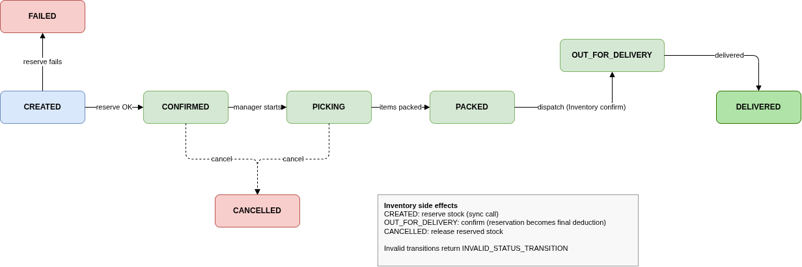

# Dark Store

Dark Store is a dark-grocery platform for browsing products, placing orders, managing inventory, and processing customer and manager order workflows. The application is organized as a Flutter client, an API gateway, and separate domain services.

## Product structure

### Client

- **Flutter App (Dev 4):** Customer and manager UI built around role-based experiences.
- **Customer features:** Browse products, manage profile and addresses, place orders, and track order history.
- **Manager features:** Manage catalog, inventory, orders, stores, and store staff.
- **Platform services:** Dio for HTTP communication, BLoC or Riverpod for state management, and secure storage for credentials.

### API and services

- **API Gateway (Dev 1):** Spring Cloud Gateway is the public entry point. It validates JWTs and routes requests to the services.
- **Auth and User Service (Dev 1):** Registration, login, token refresh and logout, role management, profiles and addresses, store data, and store-to-user mappings.
- **Catalog and Inventory Service (Dev 2):** Product and category management, store-specific pricing, stock reservations and releases, stock movements, and low-stock reporting.
- **Order and Fulfillment Service (Dev 3):** Cart and order placement, order status transitions, manager order handling, payment status, order history, and tracking.

All external requests enter through the API gateway. The gateway forwards user, catalog, inventory, and order routes to the corresponding service and propagates identity and correlation headers.

### Data ownership

Each service owns its PostgreSQL database and must not access another service's database directly:

| Service | Database | Main data |
| --- | --- | --- |
| Auth and User | `auth_db` | Users, roles, addresses, stores, and store staff |
| Catalog and Inventory | `inventory_db` | Products, categories, store inventory, stock movement and reservations |
| Order and Fulfillment | `quick_commerce_db` | Carts, orders, order items, status history and payments |

## Service interaction rules

- The Flutter app communicates with services only through the API gateway.
- The gateway validates JWTs and forwards `X-User-Id`, `X-User-Role`, `X-Store-Id`, and `X-Correlation-Id`.
- Catalog, inventory, and order records use cross-service foreign keys only as stable references; services do not share databases.
- Inventory changes are part of the order lifecycle:
  - `CREATED` reserves stock.
  - `CONFIRMED` keeps the reservation.
  - `OUT_FOR_DELIVERY` confirms inventory use.
  - `CANCELLED` releases reserved stock.
- Reservation and release operations are idempotent and follow internal service APIs.

## Order lifecycle

The order lifecycle is:

`CREATED -> CONFIRMED -> PICKING -> PACKED -> OUT_FOR_DELIVERY -> DELIVERED`

An order can move to `CANCELLED` from `CONFIRMED` or `PICKING`. If stock reservation fails, the order becomes `FAILED`.

Invalid status transitions are rejected as `INVALID_STATUS_TRANSITION`.

## Run locally

### Prerequisites

- Java 17 (all backend services target Java 17)
- Maven is optional because the Maven Wrapper is included
- PostgreSQL running on `localhost:5432`
- Postman Desktop for the API workflow

The root `pom.xml` is the Maven aggregator for all four independent applications. Run this from the repository root to compile and test every service:

**Linux/macOS:**
```bash
bash ./mvnw test
```

**Windows PowerShell:**
```powershell
.\mvnw.cmd test
```

Start PostgreSQL first and create `auth_db`, `inventory_db`, and `quick_commerce_db` if they do not already exist.

```bash
psql -U postgres -h localhost -p 5432
```

In the `psql` prompt, create any missing databases:
```sql
CREATE DATABASE auth_db;
CREATE DATABASE inventory_db;
CREATE DATABASE quick_commerce_db;
\q
```

### Configure environment variables

From the repository root, copy the example environment file:

**Linux/macOS:**
```bash
cp .env.example .env
```

**Windows PowerShell:**
```powershell
Copy-Item .env.example .env
```

Edit `.env` and replace every placeholder with a local value:

```properties
DB_URL=jdbc:postgresql://localhost:5432/auth_db
DB_USERNAME=postgres
DB_PASSWORD=your-local-postgres-password

JWT_SECRET=your-generated-secret-at-least-32-characters
INVENTORY_INTERNAL_TOKEN=your-generated-inventory-token

ADMIN_PASSWORD=your-local-admin-password
AUTH_SERVICE_URL=http://localhost:8081
INVENTORY_SERVICE_URL=http://localhost:8082
ORDER_SERVICE_URL=http://localhost:8083
```

Generate secrets locally:

```bash
openssl rand -base64 32
openssl rand -hex 32
```

Use the Base64 result as `JWT_SECRET` in both Auth and the Gateway. Use the hex result as `INVENTORY_INTERNAL_TOKEN` in Inventory and Cart/Order. Keep the Inventory and Cart/Order value identical.

Never use the placeholder text as a real secret, and never commit `.env`. If secrets are already shared or committed, rotate them.

The Auth, Inventory, and Gateway services do not automatically load `.env`; load it into each terminal before starting them.

### Start the services

Open four terminals at the repository root and leave each process running. Start Auth, Inventory, and Cart/Order first, then start the Gateway.

**Terminal 1 — Auth Service (port 8081):**

**Linux/macOS:**
```bash
set -a; source ./.env; set +a
bash ./mvnw -f darkstore-backend/auth-service/pom.xml spring-boot:run
```

**Windows PowerShell:**
```powershell
Get-Content .env | ForEach-Object {
  if ($_ -match '^(?!#)([^=]+)=(.*)$') {
    [Environment]::SetEnvironmentVariable($Matches[1], $Matches[2], 'Process')
  }
}
.\mvnw.cmd -f darkstore-backend\auth-service\pom.xml spring-boot:run
```

**Terminal 2 — Catalog and Inventory Service (port 8082):**

**Linux/macOS:**
```bash
set -a; source ./.env; set +a
export SPRING_DATASOURCE_PASSWORD="$DB_PASSWORD"
bash ./mvnw -f darkstore-backend/Inventory/pom.xml spring-boot:run
```

**Windows PowerShell:**
```powershell
Get-Content .env | ForEach-Object {
  if ($_ -match '^(?!#)([^=]+)=(.*)$') {
    [Environment]::SetEnvironmentVariable($Matches[1], $Matches[2], 'Process')
  }
}
$env:SPRING_DATASOURCE_PASSWORD = $env:DB_PASSWORD
.\mvnw.cmd -f darkstore-backend\Inventory\pom.xml spring-boot:run
```

**Terminal 3 — Cart-Order Service (port 8083):**

**Linux/macOS:**
```bash
set -a; source ./.env; set +a
bash ./mvnw -f darkstore-backend/order-service/pom.xml spring-boot:run
```

**Windows PowerShell:**
```powershell
Get-Content .env | ForEach-Object {
  if ($_ -match '^(?!#)([^=]+)=(.*)$') {
    [Environment]::SetEnvironmentVariable($Matches[1], $Matches[2], 'Process')
  }
}
.\mvnw.cmd -f darkstore-backend\order-service\pom.xml spring-boot:run
```

**Terminal 4 — API Gateway (port 8080):**

**Linux/macOS:**
```bash
set -a; source ./.env; set +a
bash ./mvnw -f darkstore-backend/api-gateway/pom.xml spring-boot:run
```

**Windows PowerShell:**
```powershell
Get-Content .env | ForEach-Object {
  if ($_ -match '^(?!#)([^=]+)=(.*)$') {
    [Environment]::SetEnvironmentVariable($Matches[1], $Matches[2], 'Process')
  }
}
.\mvnw.cmd -f darkstore-backend\api-gateway\pom.xml spring-boot:run
```

Wait for each startup message. Client/Postman requests go through the Gateway at `http://localhost:8080`. The JWT secret must match in Auth and Gateway; the Inventory token must match in Inventory and Cart/Order.

### Verify the services

**Linux/macOS:**
```bash
curl -f http://localhost:8082/actuator/health
curl -f http://localhost:8083/actuator/health
curl -I http://localhost:8080/admin
```

Inventory and order health endpoints should return `200` with `"status":"UP"`. The admin page through the Gateway should return `200`.

For gateway login verification:
```bash
curl -i -X POST http://localhost:8080/api/v1/auth/login \
  -H 'Content-Type: application/json' \
  -d '{"email":"admin@darkstore.com","password":"your-local-admin-password"}'
```
Successful login returns `200` and an access token.

**Windows PowerShell:**
```powershell
Invoke-RestMethod http://localhost:8082/actuator/health
Invoke-RestMethod http://localhost:8083/actuator/health
Invoke-WebRequest http://localhost:8080/admin
```

Check the expected listeners:

**Linux/macOS:**
```bash
ss -ltn | grep -E ':(5432|8080|8081|8082|8083)[[:space:]]'
```

**Windows PowerShell:**
```powershell
Get-NetTCPConnection -State Listen |
    Where-Object { $_.LocalPort -in 5432, 8080, 8081, 8082, 8083 } |
    Sort-Object LocalPort |
    Select-Object LocalAddress, LocalPort, OwningProcess
```

## Product diagrams

### System architecture


This diagram shows the Flutter client, API gateway, three domain services, and each service's separate PostgreSQL database.

### Order status flow



This diagram shows normal fulfillment, cancellation paths, reservation failure, and the inventory effects associated with each transition.

### Order placement sequence


This sequence starts when the Flutter app sends `POST /orders` through the gateway. The order service calculates prices, validates inventory, saves the order, reserves stock, and returns the final status and timeline. The app refreshes order status every 10-15 seconds; a manager or inventory confirmation action advances or confirms the relevant workflow.

## Postman: all services

Import [the all-services collection](./postman/DarkStore-All-Services.postman_collection.json) and [the local environment](./postman/DarkStore-Local.postman_environment.json). Start PostgreSQL and the four applications using the [local run instructions](#run-locally). Set `adminPassword` to the password configured for Auth and `inventoryInternalToken` to the same value configured in Inventory and Cart-Order.

Run the full collection in order with Postman's Collection Runner, or run the `9. Catalog CRUD` folder from its first request (`Login admin for catalog CRUD`). Do not send dependent catalog requests individually: they require the login and IDs created earlier in the folder. The collection covers the CRUD actions exposed by Auth, catalog, inventory, and cart APIs, plus checkout, payment, cancellation, fulfillment, and inventory reservation interactions. It creates persistent local test data; use a development database, not production. The API does not expose delete operations for users, stores, orders, or payments, so the collection does not invent them.