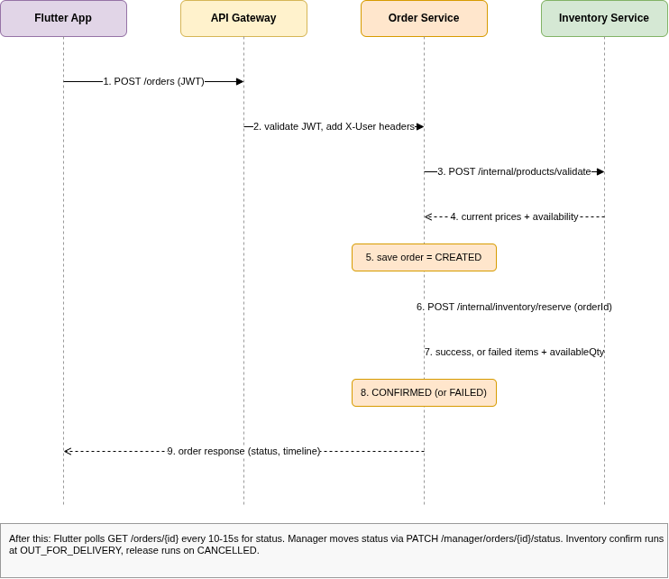

# Dark Store

Dark Store is a dark-grocery platform for browsing products, placing orders, managing inventory, and processing customer and manager order workflows. The application is organized as a Flutter client, an API gateway, and separate domain services.

## Product structure

### Client

- **Flutter App (Dev 4):** Customer and manager UI built around role-based experiences.
- **Customer features:** Browse products, manage profile and addresses, place orders, and track order history.
- **Manager features:** Manage catalog, inventory, orders, stores, and store staff.
- **Platform services:** Dio for HTTP communication, BLoC or Riverpod for state management, and secure storage for credentials.

### API and services

- **API Gateway (Dev 1):** Spring Cloud Gateway is the public entry point. It validates JWTs and routes requests to the services.
- **Auth and User Service (Dev 1):** Registration, login, token refresh and logout, role management, profiles and addresses, store data, and store-to-user mappings.
- **Catalog and Inventory Service (Dev 2):** Product and category management, store-specific pricing, stock reservations and releases, stock movements, and low-stock reporting.
- **Order and Fulfillment Service (Dev 3):** Cart and order placement, order status transitions, manager order handling, payment status, order history, and tracking.

All external requests enter through the API gateway. The gateway forwards user, catalog, inventory, and order routes to the corresponding service and propagates identity and correlation headers.

### Data ownership

Each service owns its PostgreSQL database and must not access another service's database directly:

| Service | Database | Main data |
| --- | --- | --- |
| Auth and User | `auth_db` | Users, roles, addresses, stores, and store staff |
| Catalog and Inventory | `inventory_db` | Products, categories, store inventory, stock movement and reservations |
| Order and Fulfillment | `quick_commerce_db` | Carts, orders, order items, status history and payments |

## Service interaction rules

- The Flutter app communicates with services only through the API gateway.
- The gateway validates JWTs and forwards `X-User-Id`, `X-User-Role`, `X-Store-Id`, and `X-Correlation-Id`.
- Catalog, inventory, and order records use cross-service foreign keys only as stable references; services do not share databases.
- Inventory changes are part of the order lifecycle:
  - `CREATED` reserves stock.
  - `CONFIRMED` keeps the reservation.
  - `OUT_FOR_DELIVERY` confirms inventory use.
  - `CANCELLED` releases reserved stock.
- Reservation and release operations are idempotent and follow internal service APIs.

## Order lifecycle

The order lifecycle is:

`CREATED -> CONFIRMED -> PICKING -> PACKED -> OUT_FOR_DELIVERY -> DELIVERED`

An order can move to `CANCELLED` from `CONFIRMED` or `PICKING`. If stock reservation fails, the order becomes `FAILED`.

Invalid status transitions are rejected as `INVALID_STATUS_TRANSITION`.

## Product diagrams

### System architecture

This diagram shows the Flutter client, API gateway, three domain services, and each service's separate PostgreSQL database.

### Order status flow

This diagram shows normal fulfillment, cancellation paths, reservation failure, and the inventory effects associated with each transition.

### Order placement sequence

This sequence starts when the Flutter app sends `POST /orders` through the gateway. The order service calculates prices, validates inventory, saves the order, reserves stock, and returns the final status and timeline. The app refreshes order status every 10-15 seconds; a manager or inventory confirmation action advances or confirms the relevant workflow.