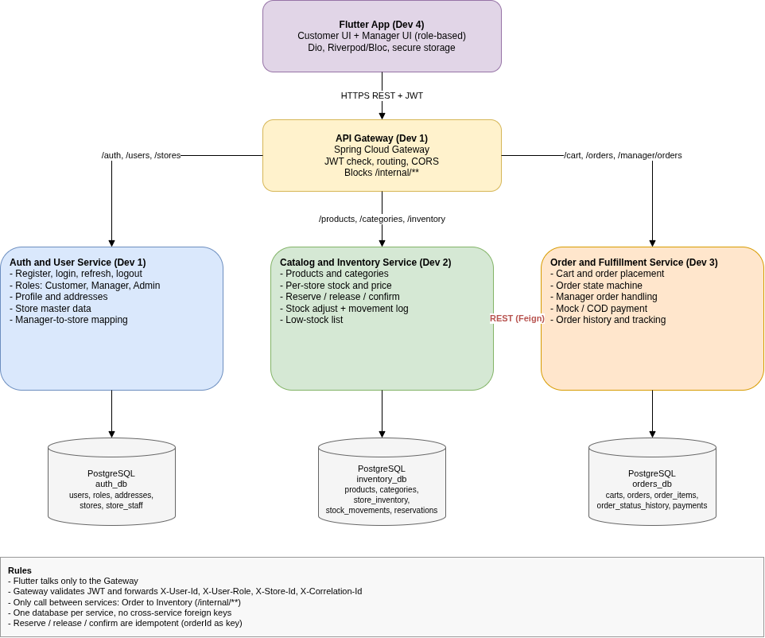

# Dark Store

Dark Store is a dark-grocery platform for browsing products, placing orders, managing inventory, and processing customer and manager order workflows. The application is organized as a Flutter client, an API gateway, and separate domain services.

## Product structure

### Client

- **Flutter App (Dev 4):** Customer and manager UI built around role-based experiences.
- **Customer features:** Browse products, manage profile and addresses, place orders, and track order history.
- **Manager features:** Manage catalog, inventory, orders, stores, and store staff.
- **Platform services:** Dio for HTTP communication, BLoC or Riverpod for state management, and secure storage for credentials.

### API and services

- **API Gateway (Dev 1):** Spring Cloud Gateway is the public entry point. It validates JWTs and routes requests to the services.
- **Auth and User Service (Dev 1):** Registration, login, token refresh and logout, role management, profiles and addresses, store data, and store-to-user mappings.
- **Catalog and Inventory Service (Dev 2):** Product and category management, store-specific pricing, stock reservations and releases, stock movements, and low-stock reporting.
- **Order and Fulfillment Service (Dev 3):** Cart and order placement, order status transitions, manager order handling, payment status, order history, and tracking.

All external requests enter through the API gateway. The gateway forwards user, catalog, inventory, and order routes to the corresponding service and propagates identity and correlation headers.

### Data ownership

Each service owns its PostgreSQL database and must not access another service's database directly:

| Service | Database | Main data |
| --- | --- | --- |
| Auth and User | `auth_db` | Users, roles, addresses, stores, and store staff |
| Catalog and Inventory | `inventory_db` | Products, categories, store inventory, stock movement and reservations |
| Order and Fulfillment | `quick_commerce_db` | Carts, orders, order items, status history and payments |

## Service interaction rules

- The Flutter app communicates with services only through the API gateway.
- The gateway validates JWTs and forwards `X-User-Id`, `X-User-Role`, `X-Store-Id`, and `X-Correlation-Id`.
- Catalog, inventory, and order records use cross-service foreign keys only as stable references; services do not share databases.
- Inventory changes are part of the order lifecycle:
  - `CREATED` reserves stock.
  - `CONFIRMED` keeps the reservation.
  - `OUT_FOR_DELIVERY` confirms inventory use.
  - `CANCELLED` releases reserved stock.
- Reservation and release operations are idempotent and follow internal service APIs.

## Order lifecycle

The order lifecycle is:

`CREATED -> CONFIRMED -> PICKING -> PACKED -> OUT_FOR_DELIVERY -> DELIVERED`

An order can move to `CANCELLED` from `CONFIRMED` or `PICKING`. If stock reservation fails, the order becomes `FAILED`.

Invalid status transitions are rejected as `INVALID_STATUS_TRANSITION`.

## Run locally

### Prerequisites

- Java 21 (Auth, Gateway, and Cart-Order target Java 17; Inventory requires Java 21)
- Maven 3.9+
- PostgreSQL running on `localhost:5432`
- Postman Desktop for the API workflow

All commands below are run from the repository root. Start PostgreSQL first. Create the databases once; the `\gexec` statements skip databases that already exist:

```bash
sudo -u postgres psql
```

In the `psql` prompt, set a local password for the `postgres` role and create the service databases:

```sql
\password postgres
SELECT 'CREATE DATABASE auth_db OWNER postgres' WHERE NOT EXISTS (SELECT 1 FROM pg_database WHERE datname = 'auth_db') \gexec
SELECT 'CREATE DATABASE inventory_db OWNER postgres' WHERE NOT EXISTS (SELECT 1 FROM pg_database WHERE datname = 'inventory_db') \gexec
SELECT 'CREATE DATABASE quick_commerce_db OWNER postgres' WHERE NOT EXISTS (SELECT 1 FROM pg_database WHERE datname = 'quick_commerce_db') \gexec
\q
```

Use the password you entered for `\password postgres` in the relevant service terminal below. These are local-development credentials; do not reuse them in production or commit real credentials to the repository.

Open four terminals at the repository root. Export the variables and start the application in each terminal; leave each terminal open while testing.

**Terminal 1 — Auth Service (port 8081):**

```bash
export DB_PASSWORD='your-local-postgres-password'
export JWT_SECRET='darkstore-dev-secret-key-change-in-production-0123456789'
export ADMIN_PASSWORD='Admin@123'
mvn -f darkstore-backend/auth-service/pom.xml spring-boot:run
```

**Terminal 2 — Catalog and Inventory Service (port 8082):**

```bash
export SPRING_DATASOURCE_PASSWORD='your-local-postgres-password'
export INVENTORY_INTERNAL_TOKEN='darkstore-local-inventory-token-123'
mvn -f darkstore-backend/Inventory/pom.xml spring-boot:run
```

**Terminal 3 — Cart-Order Service (port 8083):**

```bash
export DB_PASSWORD='your-local-postgres-password'
export INVENTORY_INTERNAL_TOKEN='darkstore-local-inventory-token-123'
mvn spring-boot:run
```

**Terminal 4 — API Gateway (port 8080):**

```bash
export JWT_SECRET='darkstore-dev-secret-key-change-in-production-0123456789'
mvn -f darkstore-backend/api-gateway/pom.xml spring-boot:run
```

The JWT secret must be identical in Auth and Gateway. The internal token must be identical in Inventory, Cart-Order, and the Postman environment. The URLs default to localhost ports `8081`–`8083`; the Gateway is the client entry point on `8080`. Wait for each service's startup message before sending requests. Inventory health can be checked with:

```bash
curl http://localhost:8082/actuator/health
```

To confirm all applications are listening on Linux:

```bash
ss -lntp | grep -E ':5432|:8080|:8081|:8082|:8083'
```

## Product diagrams

### System architecture



This diagram shows the Flutter client, API gateway, three domain services, and each service's separate PostgreSQL database.

### Order status flow


This diagram shows normal fulfillment, cancellation paths, reservation failure, and the inventory effects associated with each transition.

### Order placement sequence


This sequence starts when the Flutter app sends `POST /orders` through the gateway. The order service calculates prices, validates inventory, saves the order, reserves stock, and returns the final status and timeline. The app refreshes order status every 10-15 seconds; a manager or inventory confirmation action advances or confirms the relevant workflow.

## Postman: all services

Import [the all-services collection](./postman/DarkStore-All-Services.postman_collection.json) and [the local environment](./postman/DarkStore-Local.postman_environment.json). Start PostgreSQL and the four applications using the [local run instructions](#run-locally). The local environment uses the development admin password `Admin@123`; change it if Auth is configured with a different `ADMIN_PASSWORD`. Set `inventoryInternalToken` to the same value configured in Inventory and Cart-Order (the example above is `darkstore-local-inventory-token-123`).

Run the full collection in order with Postman's Collection Runner, or run the `9. Catalog CRUD` folder from its first request (`Login admin for catalog CRUD`). Do not send dependent catalog requests individually: they require the login and IDs created earlier in the folder. The collection covers the CRUD actions exposed by Auth, catalog, inventory, and cart APIs, plus checkout, payment, cancellation, fulfillment, and inventory reservation interactions. It creates persistent local test data; use a development database, not production. The API does not expose delete operations for users, stores, orders, or payments, so the collection does not invent them.