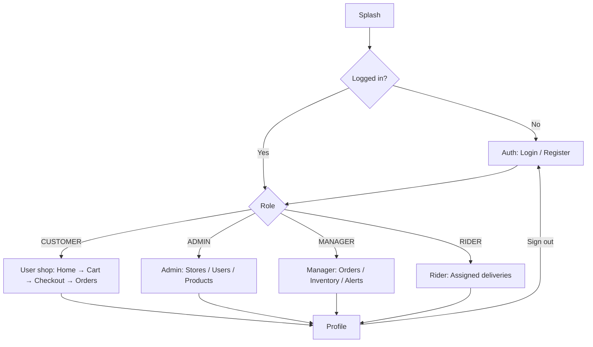

# iDarkStore — UI Flow Guide (for Managers & New Developers)

This document explains **how the product UI is built**, **how a user moves from screen to screen**, and **which Flutter files own each step**. It is written so a manager can follow the business journey, and a developer can open the matching file quickly.

---

## 1. Manager overview

iDarkStore is a **role-based web shopping and operations app**. After login (or register), the system does not show one generic dashboard; it opens the correct workspace for that person’s job. A **Customer** browses a darkstore catalogue, adds items to cart, checks out, and tracks orders. An **Admin** configures stores, staff accounts, and the product catalogue. A **Manager** runs one store: packing queue, rider assignment, stock, and low-stock alerts. A **Rider** sees only deliveries assigned to them and updates status through to delivered. Shared chrome (logo, green–yellow backdrop, white page cards, headers) keeps the brand consistent while each role stays focused on its own tasks. Navigation is guarded so one role cannot open another role’s URLs by typing them in the address bar.

---

## 2. How the UI is made (structure)

| Layer | Folder | Purpose |
|-------|--------|---------|
| App entry | `lib/main.dart`, `lib/app.dart` | Starts Flutter, wires Riverpod, applies theme |
| Routing | `lib/core/router/app_router.dart` | Maps URLs → screens; redirects by login + role |
| Auth state | `lib/features/auth/application/` | Login, register, session restore, logout |
| Role UIs | `lib/features/{user,admin,manager,rider}/presentation/` | Screens the person actually sees |
| Shared look | `lib/shared/widgets/` | Shells, headers, logo, empty/error states |
| Data models | `lib/shared/models/` | User, store, product, cart, order, address shapes |
| API / mocks | `lib/core/network/`, `lib/placeholders/` | Live Gateway or local mock JSON for demos |

**Design pattern:** each feature has **presentation** (screens/widgets) and **application** (repositories that call HTTP). Screens stay thin: they show data and call actions; repositories talk to the Gateway (or mocks).

**Visual system:** almost every authenticated page sits on `BrandBackdrop` (soft green–yellow gradient) with a white `PageSurfaceCard`. Customer shopping uses `ShopShell` + `ShopWebHeader`. Ops roles (Admin / Manager / Rider) use `RoleShellScaffold` with Profile and Logout actions.

---

## 3. Entry & authentication flow

```
App start → Splash → (session?) → Role home
                      ↓ no
                   Login / Register → Role home
```

| Step | Screen / file | Purpose |
|------|---------------|---------|
| Boot | `splash_screen.dart` | Brief loading while tokens/session are restored |
| Login & Register | `auth_screen.dart` | Single card with Login / Register tabs; demo chips when mocks are on |
| Session logic | `auth_controller.dart`, `auth_repository.dart` | Calls Gateway auth APIs; stores tokens; exposes current user + role |
| Route guard | `app_router.dart` | Sends user to `/user`, `/admin`, `/manager`, or `/rider` from `user.role` |

**Register tab:** user picks a **Role** (User / Admin / Manager / Rider), fills name, email, password. After create + auto-login, the router opens that role’s home. On the live Gateway, public register is **CUSTOMER-only**; mocks allow other roles for demos.

**Login tab:** email + password only. The account’s stored role decides which UI opens (not a login dropdown).

**Profile (all roles):** `profile_screen.dart` — name, email, role, phone, store id; customers also manage **saved addresses**. Sign out clears the session and returns to login.

---

## 4. Customer (User) UI flow

Business journey: **pick store → browse → product detail → cart → checkout → confirmation → orders**.

```
/user (home)
  → /user/stores (optional store pick)
  → /user/products or /user/products/:id
  → cart preview / /user/cart
  → /user/checkout
  → /user/orders/:id/confirmation
  → /user/orders → /user/orders/:id
  → /user/profile
```

| File | Purpose |
|------|---------|
| `user_home_screen.dart` | Blinkit-style home: hero, promos, category strip, product rows |
| `store_picker_screen.dart` | Choose which darkstore serves the order |
| `product_list_screen.dart` | Search / category product grid |
| `product_detail_screen.dart` | Qty stepper, add to cart, snackbar with “View cart” |
| `cart_screen.dart` / `cart_preview_card.dart` | Full cart page and header cart popover |
| `checkout_screen.dart` | Address list, add/edit address, place order |
| `address_editor_dialog.dart` | Modal to add or edit a delivery address |
| `order_confirmation_screen.dart` | Success page with My Orders / Track / Shop actions |
| `order_list_screen.dart` | Customer’s past and open orders |
| `order_detail_screen.dart` | Status timeline and line items; cancel when allowed |
| `shop_shell.dart` + `shop_web_header.dart` | Sticky header: logo, delivery location, search, Orders, Profile, Cart, Logout |

**Header behaviour:** location chip opens store picker; search goes to product list; Cart opens the preview card; Profile / Logout are direct actions (no fragile popup menu).

---

## 5. Admin UI flow

Business journey: **platform control** — stores, staff (manager/rider), catalogue.

```
/admin (home hub)
  → /admin/stores
  → /admin/users
  → /admin/products
  → /admin/profile
```

| File | Purpose |
|------|---------|
| `admin_home_screen.dart` | Hub cards linking to stores, users, products |
| `admin_stores_screen.dart` | Create / edit stores; activate or deactivate |
| `admin_users_screen.dart` | Create MANAGER / RIDER with store; enable / disable accounts |
| `admin_products_screen.dart` | Catalogue products and categories; activate / deactivate |
| `role_shell_scaffold.dart` | Shared ops chrome (title, Profile, Logout) |

Admins do **not** shop; they configure the network that customers and store teams use.

---

## 6. Manager UI flow

Business journey: **run one store** — accept queue, pack, assign rider, watch stock.

```
/manager (home)
  → /manager/orders → /manager/orders/:orderId
  → /manager/inventory
  → /manager/alerts
  → /manager/profile
```

| File | Purpose |
|------|---------|
| `manager_home_screen.dart` | Store-scoped landing with shortcuts |
| `manager_orders_screen.dart` | Order queue with status filters |
| `manager_order_detail_screen.dart` | Advance status; assign a rider when packed |
| `manager_inventory_screen.dart` | Stock levels; add product stock for the store |
| `manager_alerts_screen.dart` | Low-stock / inventory alerts |

Everything is scoped by the manager’s `storeId` from login. They cannot see another store’s queue.

---

## 7. Rider UI flow

Business journey: **deliver** — see assigned jobs, mark out for delivery, mark delivered.

```
/rider (home list)
  → /rider/orders/:orderId
  → /rider/profile
```

| File | Purpose |
|------|---------|
| `rider_home_screen.dart` | List of assigned / out-for-delivery orders for this rider + store |
| `rider_order_detail_screen.dart` | Address, COD amount, next legal status action |

Riders only see orders **assigned to them**. Status buttons follow the allowed timeline (Assigned → Out for delivery → Delivered).

---

## 8. Shared UI building blocks

| File | Purpose |
|------|---------|
| `brand_logo.dart` | Batman mark + “iDarkStore” wordmark; taps home for that role |
| `brand_backdrop.dart` | Soft green–yellow page background |
| `page_surface_card.dart` | Wide white content card with shadow/border |
| `shop_shell.dart` | Customer layout: header + scrollable card body |
| `role_shell_scaffold.dart` | Ops layout: app bar actions + session banner + card body |
| `app_empty_state.dart` | Friendly empty list placeholder |
| `app_error_view.dart` | Error message + Retry (what you see when an API fails) |
| `catalog_item_card.dart` / `product_card.dart` | Product tiles used on browse screens |

---

## 9. End-to-end picture (all roles)



---

## 10. How to merge Backend (Java / Spring Boot) with Frontend (Flutter)

Merging is not a code rewrite of the screens. The Flutter UI already calls **repositories → Dio → Gateway paths**. Turning mocks off and pointing at a running Spring Cloud Gateway is how the same UI starts using real Auth, Users, Stores, Admin, Inventory, and Order services. Both teams must agree on the **same contract** (`API_REFERENCE.md`), then prove login → role home → one happy path per role before calling the merge “done.”

### 10.1 What each side owns

| Side | Owns | Must provide |
|------|------|----------------|
| **Java / Spring Boot** | API Gateway (port **8080**), Auth, Catalog/Inventory, Order microservices | Stable JSON APIs under `/api/v1`, JWT access + refresh tokens, CORS for the Flutter web origin, shared error body `{ status, code, message }` |
| **Flutter** | Screens, routing by role, Dio client, models, repositories | `API_BASE_URL`, `USE_MOCK_APIS=false`, Bearer header, refresh-on-`TOKEN_EXPIRED`, models that match Gateway JSON (UUID ids, `fullName`, `postalCode` / `defaultAddress` / `country`, store `line1` / `state` / `postalCode`, `CUSTOMER` role, etc.) |

**Rule managers should enforce:** the browser never talks to ports **8081 / 8082 / 8083**. Only the Gateway (`…/api/v1`) is the front door.

```
Flutter Web  ──HTTPS/HTTP──►  API Gateway :8080/api/v1
                                  │
                    ┌─────────────┼─────────────┐
                    ▼             ▼             ▼
                 Auth svc    Catalog/Inv     Order svc
```

### 10.2 Things needed before merge (checklist)

#### A. Contract & data shape (agree once)

- [ ] Shared doc: [`API_REFERENCE.md`](./API_REFERENCE.md) (Auth, Users, Stores, Admin) plus Order/Inventory paths in [`BACKEND_INTEGRATION.md`](./BACKEND_INTEGRATION.md) / [`architecture.md`](./architecture.md)
- [ ] Roles as upper-case strings: `CUSTOMER`, `ADMIN`, `MANAGER`, `RIDER`
- [ ] IDs as **integers** (`id`, `storeId`)
- [ ] User uses `status`: `ACTIVE` | `DISABLED` (not only a boolean)
- [ ] Address fields: `postalCode`, `defaultAddress`, `country` (UUID address ids)
- [ ] User / staff: `fullName` (not `name`); store: `line1`, `state`, `postalCode`
- [ ] Auth login/refresh body: `accessToken`, `refreshToken`, `expiresIn` (900), nested `user`
- [ ] Errors always: `{ "status", "code", "message" }` — Flutter branches on `code`

#### B. Java / Spring Boot readiness

- [ ] Gateway running and reachable at `http://localhost:8080/api/v1` (web/desktop)
- [ ] Routes for `/auth/**`, `/users/me/**`, `/stores/**`, `/admin/users/**`, plus catalog/cart/orders as per team ownership
- [ ] JWT issued with claims the app expects (`role`, `storeId` for MANAGER/RIDER)
- [ ] Refresh tokens **single-use**; logout accepts `refreshToken` and returns **204**
- [ ] **CORS** for Flutter web origin `http://localhost:5000`: allow `Authorization`, `Content-Type`, `X-Correlation-Id`, and needed methods
- [ ] Seed/test admin: `admin@darkstore.com` / `Admin@123` (or equivalent documented credentials)
- [ ] No requirement for Flutter to call `/internal/**`

#### C. Flutter readiness

- [ ] `lib/core/config/app_config.dart` — base URL includes `/api/v1`
- [ ] `lib/core/network/api_endpoints.dart` — paths match Gateway
- [ ] `dio_client.dart` + `auth_interceptor.dart` — Bearer + refresh retry
- [ ] Models under `lib/shared/models/` parse live JSON (ints and enums)
- [ ] Repositories under `lib/features/*/application/` use `ApiEndpoints` only
- [ ] Run **without** mocks:

```bash
flutter run -d chrome --web-hostname=localhost --web-port=5000 \
  --dart-define=USE_MOCK_APIS=false \
  --dart-define=API_BASE_URL=http://localhost:8080/api/v1 \
  --dart-define=ENABLE_API_LOGS=true
```

Frontend: **http://localhost:5000** (Gateway CORS should allow this origin).

#### D. Environment & ops

| Need | Why |
|------|-----|
| Same machine / VPN / Wi‑Fi | Phone or another PC must reach the laptop Gateway IP |
| Firewall allows **8080** | Otherwise “Failed to load stores” with no JSON body |
| HTTPS or correct CORS in staging | Browsers block cross-origin calls otherwise |
| Logging (`ENABLE_API_LOGS` + Gateway logs) | Correlate Flutter `X-Correlation-Id` with server traces |

### 10.3 Practical merge steps (order of work)

1. **Backend up** — Gateway + Auth at least; prove with curl login from [`API_REFERENCE.md`](./API_REFERENCE.md) §11.
2. **Flutter flip** — `USE_MOCK_APIS=false` and correct `API_BASE_URL`.
3. **Auth first** — login, register (CUSTOMER), refresh, logout; confirm role opens `/user`, `/admin`, `/manager`, or `/rider`.
4. **Profile & stores** — `GET /users/me`, `GET /stores` (filter `active` in the app).
5. **Role happy paths** — Customer: browse → cart → checkout; Admin: store/user; Manager: orders; Rider: assigned list.
6. **Failure paths** — wrong password (`INVALID_CREDENTIALS`), expired access (`TOKEN_EXPIRED` → refresh), disabled account (`ACCOUNT_DISABLED` → login).
7. **Turn off demo-only behaviour** — Register role dropdown for staff is for mocks; live staff creation stays Admin `POST /admin/users`.

### 10.4 What “merged” means for a manager

| Done means | Not done yet |
|------------|--------------|
| Demo accounts work against the real Gateway | UI still shows mock data with `USE_MOCK_APIS=true` |
| Each role lands on the correct home after login | Screens load but APIs 404 / CORS fail |
| Cart and store ops persist in the database | Data disappears on refresh (still mock memory) |
| Token expiry refreshes without forcing logout every 15 minutes | Every protected call kicks the user to login |

### 10.5 Where to look in code (quick map)

| Concern | Flutter file | Backend counterpart |
|---------|--------------|---------------------|
| Base URL / mock switch | `lib/core/config/app_config.dart` | Gateway host + `/api/v1` |
| Path list | `lib/core/network/api_endpoints.dart` | Controller `@RequestMapping` paths |
| HTTP + JWT header | `lib/core/network/dio_client.dart` | Spring Security filter chain |
| 401 refresh | `lib/core/network/auth_interceptor.dart` | `/auth/refresh` |
| Login / register UI | `lib/features/auth/presentation/auth_screen.dart` | Auth service |
| Role → screen | `lib/core/router/app_router.dart` | JWT `role` claim + `/users/me` |

Full technical checklist and dart-defines: [`BACKEND_INTEGRATION.md`](./BACKEND_INTEGRATION.md).

---

## 11. Related documents

| Doc | What it covers |
|-----|----------------|
| [`README.md`](./README.md) | How to run the app and demo accounts |
| [`API_REFERENCE.md`](./API_REFERENCE.md) | Gateway Auth / Users / Stores / Admin contracts |
| [`BACKEND_INTEGRATION.md`](./BACKEND_INTEGRATION.md) | Dio, mocks vs live Gateway, dart-defines |
| [`architecture.md`](./architecture.md) | Broader system architecture |

---

## 12. One-line takeaway for stakeholders

**The UI is four products in one shell:** shopping for customers, platform setup for admins, store operations for managers, and delivery execution for riders—each with its own screen set, shared branding, and a router that opens the right world the moment someone signs in. **Merging Java backends is flipping the Flutter app off mocks onto the Gateway with a shared API contract—not rebuilding the screens.**

